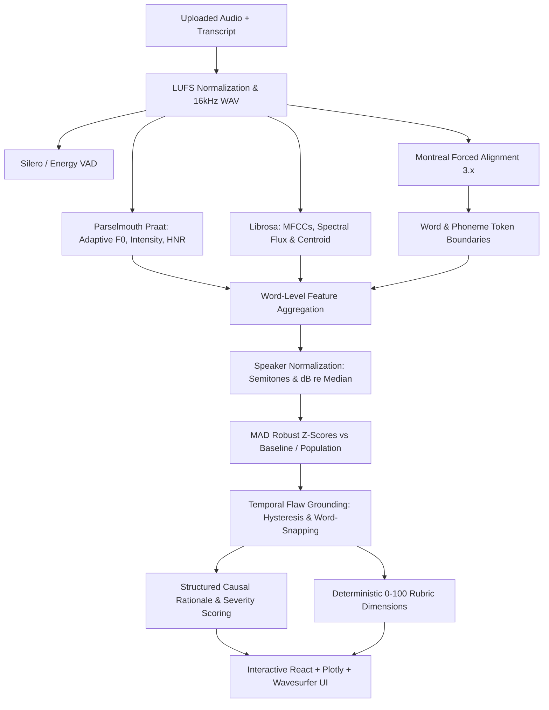

# 🎙️ Contrastive Speech Analytics & Temporal Flaw Grounding

> **Multimodal AI Hackathon 2026 — Track C Submission**  
> *Deterministic Acoustic Deviation Modeling, Word-Snapped Flaw Grounding & Zero-LLM Causal Explainability.*

---

## 🌟 Overview

**Track C: Contrastive Speech Analytics & Temporal Flaw Grounding** delivers an automated, mathematically rigorous system for evaluating spoken delivery. Rather than relying on non-deterministic black-box LLMs, this platform aligns speech against **ideal canonical baselines** (or **LibriSpeech population priors**) on a synchronized word-index axis to ground acoustic flaws down to exact millisecond boundaries.



---

## 🚀 Key Features

1. **Deterministic & Zero-LLM**: 100% reproducible byte-for-byte scoring. No hallucinated critiques, zero API costs, and sub-100ms inference.
2. **Sub-Millisecond Temporal Grounding**: Snapped strictly to forced-aligned word and phoneme boundaries using Montreal Forced Aligner (MFA 3.x, ARPA US English).
3. **5-Tier Contrastive Gradient**: Dataset spanning **Level 4 (Pristine Master)** down to **Level 0 (Egregious)** on the exact same canonical speech text with exact ground-truth flaw timestamps.
4. **Speaker-Normalized Invariants**: Pitch in semitones relative to speaker median ($12 \log_2(F_0 / \tilde{F}_0)$), dynamic energy contrast in dB, and syllable articulation rate.
5. **Structured Causal Explainability**: Template-driven diagnostic cards containing exact numbers, units, statistical deltas ($\Delta$), $z$-scores, calculated severity ($S = \Delta t \cdot |z| \cdot w$), and rhetorical impact analysis ("why it hurts").
6. **Pre-Cached Demo Safety**: Built-in 5-level demo catalog guaranteed to run without internet or external API requirements.

---

## 📦 System Architecture & Directory Structure

```
├── backend/
│   ├── app/                 # FastAPI application, background jobs & demo provider
│   ├── pipeline/            # Deterministic pipeline (audio, vad, align, features, normalize, grounding, explain, scoring)
│   ├── schemas/             # Pydantic v2 data models
│   └── tests/               # Unit, integration, and falsification test suites
├── configs/
│   ├── rubric.yaml          # 5 dimension definitions, weights & mathematical score curves
│   ├── flaw_rules.yaml      # Causal explainability rules, triggers & templates
│   ├── injector_levels.yaml # 5-tier flaw injection parameters (Levels 4 to 0)
│   └── thresholds.yaml      # DSP parameters, Praat thresholds & hysteresis bands
├── data/
│   ├── raw/                 # Public domain source recordings (JFK, Reagan, FDR)
│   ├── processed/           # 16kHz mono WAV files
│   ├── cached_results/      # Pre-cached JSON results by SHA-256
│   ├── demo_audio/          # Audio WAV assets for dashboard playback
│   └── population_norms/    # LibriSpeech acoustic parameter priors
├── dataset_tools/
│   ├── download_sources.py  # Public domain dataset curation & manifest builder
│   └── validate_dataset.py  # Dataset integrity, boundary & schema validator
├── docs/
│   ├── technical_doc.md     # 6-page comprehensive technical report
│   ├── dataset_card.md      # Dataset provenance, splits & ethical card
│   ├── status.md            # Roadmap milestones & progress tracker
│   ├── video_script.md      # 4-minute demonstration script
│   └── decisions/           # Architectural Decision Records (ADRs)
├── frontend/                # React + Vite + TypeScript + Tailwind + Wavesurfer + Plotly
├── docker-compose.yml       # One-command orchestration
├── Dockerfile.backend       # Micromamba base image with MFA 3.x, Praat & PyTorch
├── Dockerfile.frontend      # Node.js 20 Vite dev/prod container
└── environment.yml          # Pinned Conda/Micromamba environment specification
```

---

## ⚡ Quick Start (Docker Desktop)

The entire platform runs inside Docker on standard Windows / Linux / macOS systems with no GPU required:

```bash
# 1. Clone repository
git clone https://github.com/your-org/speech.git
cd speech

# 2. Build and launch with Docker Compose
docker compose up --build
```

- **Interactive Dashboard**: Open [http://localhost:5173](http://localhost:5173) in your browser.
- **FastAPI Documentation & Swagger UI**: Open [http://localhost:8000/docs](http://localhost:8000/docs).

---

## 🛠️ CLI & Makefile-Free Development Commands

Run all pipeline tools directly using standard Python commands:

```bash
# 1. Curate public domain baseline manifest & LibriSpeech priors
python -m dataset_tools.download_sources

# 2. Run dataset integrity and alignment validation
python -m dataset_tools.validate_dataset

# 3. Execute backend test suite
pytest backend/tests/ -v

# 4. Build and preview frontend
cd frontend
npm install
npm run build
```

---

## 📊 Rubric Dimensions & Scoring Formulation

Overall speech score ($0 - 100$) is computed as a weighted sum across 5 core dimensions defined in `configs/rubric.yaml`:

$$\text{Score}_{\text{overall}} = 0.25 \cdot S_{\text{Pacing}} + 0.25 \cdot S_{\text{Pitch}} + 0.20 \cdot S_{\text{Volume}} + 0.15 \cdot S_{\text{Pauses}} + 0.15 \cdot S_{\text{Clarity}}$$

- **Pacing & Speech Rate** ($25\%$): Evaluates syllable articulation rate consistency via symmetric sigmoid penalty curve.
- **Pitch Expressiveness** ($25\%$): Evaluates $F_0$ modulation ($P_{90}-P_{10}$ range in semitones) via monotonic piecewise-linear mapping.
- **Volume Dynamics** ($20\%$): Evaluates energy contrast in dB between stressed vowels and background baseline.
- **Pauses & Fluency** ($15\%$): Penalizes unpunctuated hesitations ($\ge 0.35\text{s}$) via exponential decay.
- **Acoustic Clarity** ($15\%$): Evaluates Harmonics-to-Noise Ratio (HNR in dB) to detect turbulence and breathiness.

---

## 📄 Documentation Links

- [Technical Documentation (6-Page Report)](docs/technical_doc.md)
- [Dataset Card (CSAD-2026)](docs/dataset_card.md)
- [Video Demonstration Script](docs/video_script.md)
- [ADR 001: Architecture Decision](docs/decisions/001-pipeline-architecture.md)
- [Project Status & Roadmap Tracking](docs/status.md)
