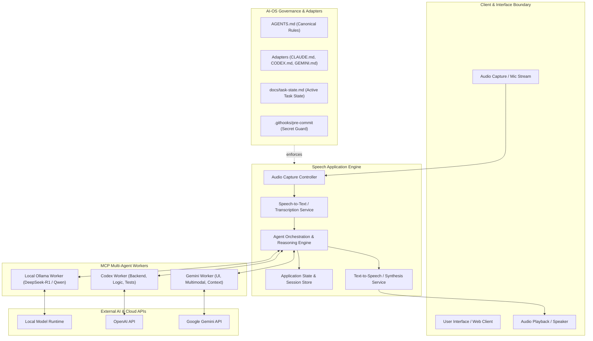

# Architecture

This document is the durable source of truth for the project's technical architecture.

---

## 1. System Purpose & Scope

- **Project Name**: Speech
- **Core Purpose**: A modern, high-performance voice and speech intelligence platform with agentic AI orchestration, speech-to-text (STT), text-to-speech (TTS), and intelligent conversational processing.
- **Value Proposition**: Combines real-time audio capture, transcription, intelligent reasoning via multi-model agents (Gemini, OpenAI Codex, and local Ollama workers), and synthesized voice response within a secure, test-driven AI Operating System (AI-OS) harness.
- **Target Users**: End-users needing voice interaction/transcription and developers building speech-enabled workflows with autonomous AI agents.

---

## 2. System Context & Boundaries

---

## 3. Component Architecture & Module Responsibilities

### AI-OS Governance & Multi-Model Harness
- [`AGENTS.md`](file:///c:/Users/HP/OneDrive/Desktop/Speech/AGENTS.md): Canonical operating instructions, engineering rules, self-modifying learning loop, and validated learned rules.
- [`GEMINI.md`](file:///c:/Users/HP/OneDrive/Desktop/Speech/GEMINI.md): Gemini IDE adapter pointing to canonical rules.
- [`CLAUDE.md`](file:///c:/Users/HP/OneDrive/Desktop/Speech/CLAUDE.md): Claude Code adapter linking to canonical rules.
- [`CODEX.md`](file:///c:/Users/HP/OneDrive/Desktop/Speech/CODEX.md): Codex / ChatGPT adapter linking to canonical rules.
- [`mcp.json`](file:///c:/Users/HP/OneDrive/Desktop/Speech/mcp.json): Model Context Protocol configuration registering:
  - `gemini-worker`: High-context multimodal analysis and UI asset generation via `@google/gemini-mcp-server`.
  - `codex-worker`: Backend implementation, filesystem operations, database migrations, and testing via `@modelcontextprotocol/server-filesystem`.
  - `local-ollama-worker`: 100% offline, privacy-first local inference (DeepSeek-R1 / Qwen 2.5 Coder) via `ollama serve`.
- [`.claude/commands/`](file:///c:/Users/HP/OneDrive/Desktop/Speech/.claude/commands): Pre-configured slash command playbooks:
  - [`audit.md`](file:///c:/Users/HP/OneDrive/Desktop/Speech/.claude/commands/audit.md): Security scanning, edge-case test falsification, and priority audit reporting.
  - [`feature.md`](file:///c:/Users/HP/OneDrive/Desktop/Speech/.claude/commands/feature.md): Structured prompt refinement and acceptance criteria planning.
  - [`interview.md`](file:///c:/Users/HP/OneDrive/Desktop/Speech/.claude/commands/interview.md): Socratic requirements interview for architectural clarity.
  - [`sync-state.md`](file:///c:/Users/HP/OneDrive/Desktop/Speech/.claude/commands/sync-state.md): Automated task state and diff synchronization into [`docs/task-state.md`](file:///c:/Users/HP/OneDrive/Desktop/Speech/docs/task-state.md).
- [`.githooks/pre-commit`](file:///c:/Users/HP/OneDrive/Desktop/Speech/.githooks/pre-commit): Automated commit-time guard blocking staged `.env` files, API keys (`sk-...`), and private keys.
- [`.ai/mistakes-candidates.md`](file:///c:/Users/HP/OneDrive/Desktop/Speech/.ai/mistakes-candidates.md): Unverified observations, friction logs, and candidate rules prior to graduation into [`docs/lessons.md`](file:///c:/Users/HP/OneDrive/Desktop/Speech/docs/lessons.md).

### Application Layer (`src/` - Planned Implementation)
- `src/audio/`: Real-time audio stream capture, buffer management, resampling (16kHz / 48kHz WAV/PCM), and Web Audio API / native device handlers.
- `src/stt/`: Speech-to-Text transcription adapters (Web Speech API, Whisper / cloud transcription endpoints).
- `src/tts/`: Text-to-Speech synthesis pipeline with audio playback queue management.
- `src/agent/`: Conversational orchestration, intent detection, prompt execution, and MCP worker routing.
- `src/ui/`: Presentation layer, reactive controls, audio visualizers, transcript viewers, and settings.
- `tests/`: Automated unit, integration, and falsification test suites.

---

## 4. Data Flow & State Management

### Standard Voice Interaction Flow
1. **Audio Capture**: User speaks into the microphone; raw PCM/WAV audio is captured and buffered in chunks.
2. **Audio Preprocessing**: Audio is normalized, noise-filtered, and streamed to the STT transcription engine.
3. **Transcription (STT)**: Speech stream is converted into intermediate/final text transcript.
4. **Intent & Agent Processing**: Text query is evaluated by the agent reasoning engine; complex tasks are dispatched to appropriate MCP workers (`gemini-worker` for UI/multimodal, `codex-worker` for logic/storage, `local-ollama-worker` for local processing).
5. **Synthesis (TTS)**: Agent response text is converted to synthesized speech audio stream.
6. **Playback & Feedback**: Audio is played back through user output speakers while UI renders transcripts and state updates.
7. **State Synchronization**: Active interaction session and task state are persisted in [`docs/task-state.md`](file:///c:/Users/HP/OneDrive/Desktop/Speech/docs/task-state.md).

---

## 5. Security & Trust Boundaries

- **Secret Zero-Trust**: All API credentials (`GEMINI_API_KEY`, `OPENAI_API_KEY`) must be loaded strictly from local environment variables or secure keychains. Never commit secrets to git.
- **Commit Guard**: [`.githooks/pre-commit`](file:///c:/Users/HP/OneDrive/Desktop/Speech/.githooks/pre-commit) inspects all staged diffs and blocks `.env` files and regex matches for private keys or API tokens.
- **Audio & PII Privacy**: User audio streams and transcripts are kept local when using `local-ollama-worker`. External API calls must sanitize or omit sensitive personal identifiable information (PII).
- **Input Sanitization**: User speech inputs are sanitized before being passed to shell commands, eval contexts, or external tool executions.

---

## 6. Operational Runbook & Environment

- **Node.js**: Compatible with Node.js 18+ / 20+ LTS.
- **MCP Worker Orchestration**: Requires `npx` and optionally `ollama` for local inference.
- **Available Commands**:
  - `npm install`: Install dependencies.
  - `npm run dev`: Start local development server / hot reload.
  - `npm test`: Execute test suites and falsification checks.
  - `npm run lint`: Code formatting and type verification.
  - `npm run build`: Production bundle compilation.
