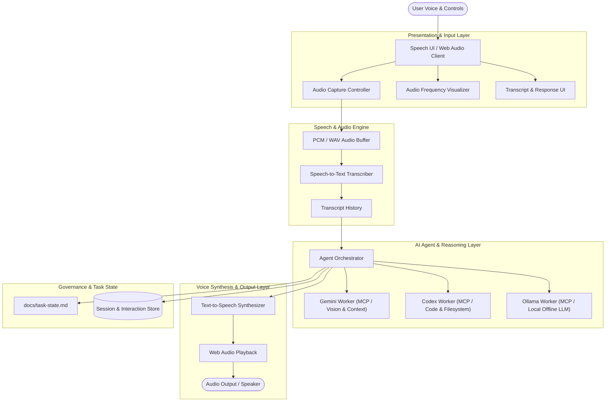
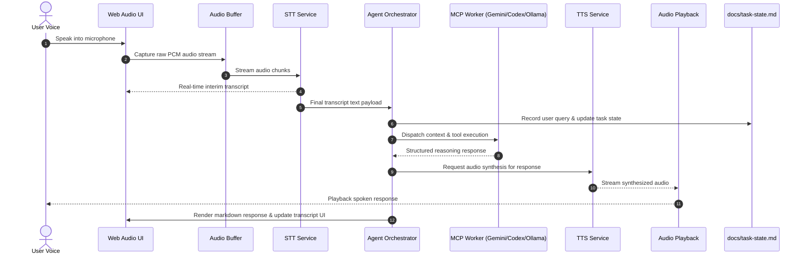
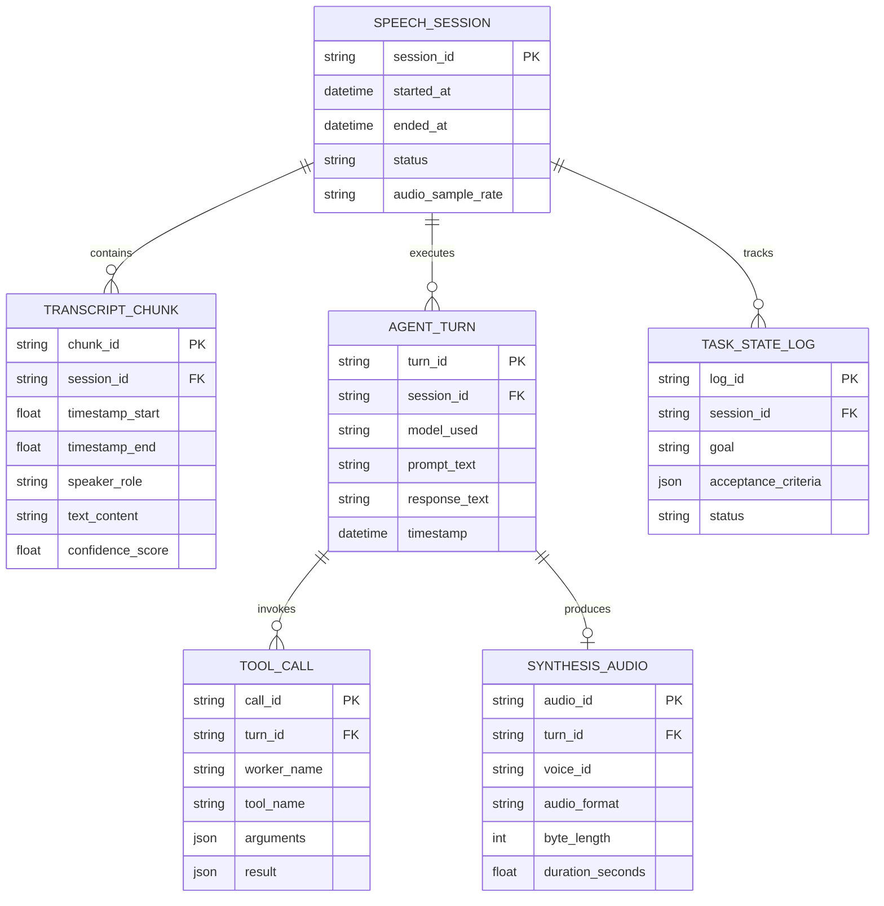

# Project Dependency & Relationship Graph

This document is the structural wiring diagram for the codebase. It maps component hierarchies, speech processing call paths, and data relationships to enable safe refactoring and instant blast-radius analysis.

---

## 1. System Context & Component Graph

---

## 2. Audio Processing & Agent Interaction Flow Graph

---

## 3. Database & Session Entity-Relationship (ER) Diagram

---

## 4. Blast Radius & Dependency Matrix

Use this table to assess downstream impacts before modifying core system modules or governance configurations:

| Core Module / File | Direct Dependents (Imported By / Regulates) | Risk Level | Blast Radius Mitigation |
| :--- | :--- | :---: | :--- |
| [`AGENTS.md`](file:///c:/Users/HP/OneDrive/Desktop/Speech/AGENTS.md) | All AI Agents, Adapters ([`CLAUDE.md`](file:///c:/Users/HP/OneDrive/Desktop/Speech/CLAUDE.md), [`CODEX.md`](file:///c:/Users/HP/OneDrive/Desktop/Speech/CODEX.md), [`GEMINI.md`](file:///c:/Users/HP/OneDrive/Desktop/Speech/GEMINI.md)) | **CRITICAL** | Ensure self-modifying learning loop rules and prompt contract requirements remain intact. |
| [`mcp.json`](file:///c:/Users/HP/OneDrive/Desktop/Speech/mcp.json) | MCP Server Runners, Orchestrator, Subagent workers | **HIGH** | Validate environment variable substitution (`${GEMINI_API_KEY}`, `${OPENAI_API_KEY}`) and CLI package availability. |
| [`.githooks/pre-commit`](file:///c:/Users/HP/OneDrive/Desktop/Speech/.githooks/pre-commit) | Git commit pipeline & developer workflow | **HIGH** | Test hook execution with mock `.env` and clean commits before modifying. |
| [`docs/task-state.md`](file:///c:/Users/HP/OneDrive/Desktop/Speech/docs/task-state.md) | Agent task handoff, developer session state | **MEDIUM** | Keep format synchronized with `/sync-state` command conventions. |
| `src/audio/` (Audio Pipeline) | STT Transcribers, Visualizer, Audio Playback | **HIGH** | Verify sample rate conversions (16kHz / 44.1kHz / 48kHz) and cross-browser Web Audio API support. |
| `src/agent/` (Agent Router) | TTS Engine, UI State, MCP Worker Clients | **HIGH** | Run integration test suite mocking worker response timeouts and stream failures. |
| `src/ui/` (Frontend Views) | User presentation & visual feedback | **LOW** | Verify responsive CSS, audio visualizer canvas sizing, and accessibility standards. |

