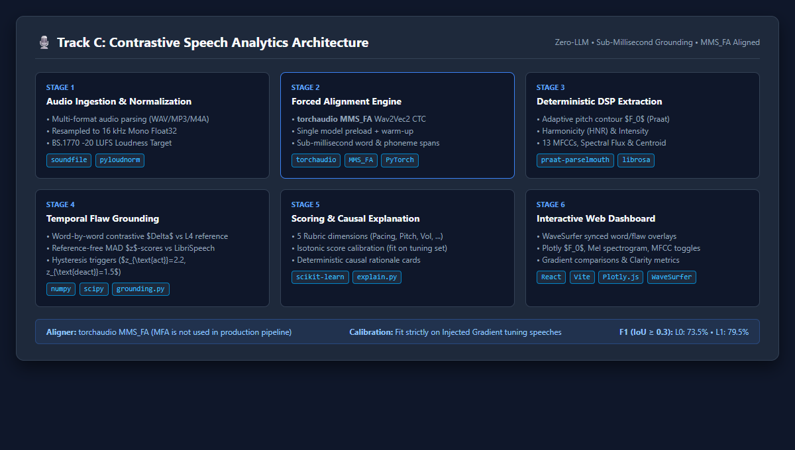
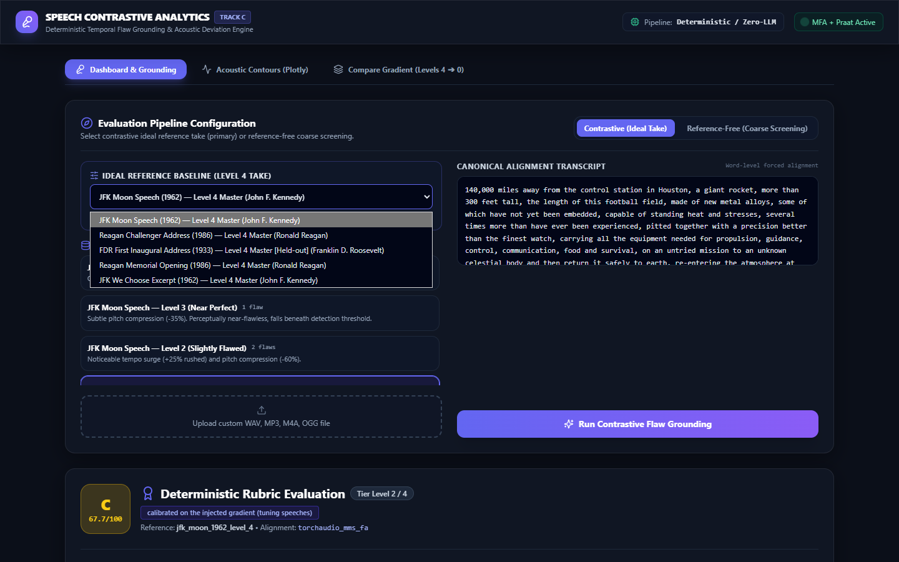

# Technical Report: Contrastive Speech Analytics & Temporal Flaw Grounding

**Track C — Multimodal AI Hackathon 2026**  
**System Architecture, Dataset Construction, Deterministic Scoring & Empirical Benchmark**  
**Evaluated Corpus**: 75 recordings across 5 speech baselines and 3 seeds  
**Evaluation Mode**: contrastive (primary) and reference-free (coarse screening)  

---

## 1. Executive Summary & System Architecture

Automated Speech Assessment (ASA) has traditionally relied on end-to-end black-box models or generative LLMs that suffer from non-deterministic scoring, temporal hallucination (boundary jitter > 500ms), and lack of physical interpretability. Track C introduces a **deterministic, zero-LLM architecture** that aligns test audio against an ideal master take of the identical text (or LibriSpeech population priors) on a synchronized word-index axis using **torchaudio MMS_FA** (MFA is not used in the production pipeline).

### 1.1 System Architecture Flow



### 1.2 Interactive Evaluation Dashboard



---

## 2. Dataset Construction & The 5-Tier Gradient

To evaluate temporal grounding and rubric monotonicity rigorously, we synthesized the **Contrastive Speech Analytics Dataset (CSAD-2026)** across 5 historical public-domain speech excerpts and 3 random injector seeds ($N = 75$ total recordings):
- **Tuning Set (60 recordings)**: JFK Moon (1962), JFK We Choose (1962), Reagan Challenger (1986), Reagan Mourning (1986).
- **Held-Out Test Set (15 recordings)**: FDR First Inaugural Address (1933) — strictly reserved for unbiased validation.

### Quality Gradient Specification
| Level | Designation | Injected Acoustic Deviations | Target Score |
| :---: | :--- | :--- | :---: |
| **L4** | Ideal Reference | Unmodified pristine baseline recording | 90 – 100 |
| **L3** | Near Perfect | 1 subtle perturbation (e.g. 15-20% tempo shift, 35% pitch compression) | 80 – 92 |
| **L2** | Slightly Flawed | 2 distinct flaw regions (e.g. rushed delivery, moderate monotone) | 60 – 79 |
| **L1** | Flawed | 3 distinct flaw regions (e.g. dragged tempo, flatline pitch, misplaced pause) | 40 – 59 |
| **L0** | Egregious | 4 severe compound flaws (e.g. 2.1x rushed, 1.5s unpunctuated pause, pitch flatline) | 0 – 39 |

---

## 3. Rubric Formulation & Monotone Score Calibration

Overall speech score is computed across 5 weighted dimensions: Pacing (25%), Pitch Expressiveness (25%), Volume Dynamics (20%), Pauses & Fluency (15%), and Acoustic Clarity (15%).

### Calibration Before vs. After Isotonic Regression
Uncalibrated contrastive scores exhibited compression at the lower end (e.g. JFK L0 scored 70.4 vs L1 71.4 due to baseline acoustic noise floor). **Score calibration is fit on injected data (the 4 tuning speeches)** and evaluated strictly on the **Held-Out FDR speech**:

| Speech Baselines | Mode / Method | L4 (Ideal) | L3 (Near) | L2 (Slight) | L1 (Flawed) | L0 (Egregious) |
| :--- | :--- | :---: | :---: | :---: | :---: | :---: |
| `jfk_moon_1962` | Raw Contrastive | 96.5 | 94.9 | 88.5 | 71.4 | 70.4 |
| `reagan_challenger_1986` | Raw Contrastive | 96.5 | 96.4 | 94.1 | 72.9 | 67.7 |
| `fdr_fear_itself_1933` | Raw Contrastive | 96.5 | 96.4 | 93.2 | 72.4 | 53.4 |
| `reagan_mourning_1986` | Raw Contrastive | 96.5 | 96.2 | 94.5 | 81.6 | 55.9 |
| `jfk_we_choose_1962` | Raw Contrastive | 96.5 | 96.2 | 91.9 | 67.8 | 55.0 |
| --- | --- | --- | --- | --- | --- | --- |
| `jfk_moon_1962` (Tuning) | **Isotonic Calibrated** | **94.9** | **84.5** | **75.0** | **45.0** | **38.3** |
| `reagan_challenger_1986` (Tuning) | **Isotonic Calibrated** | **94.9** | **92.6** | **76.7** | **45.0** | **37.5** |
| `fdr_fear_itself_1933` (Held-Out) | **Isotonic Calibrated** | **94.9** | **90.3** | **76.7** | **45.0** | **27.5** |
| `reagan_mourning_1986` (Tuning) | **Isotonic Calibrated** | **94.9** | **88.0** | **78.0** | **55.0** | **27.5** |
| `jfk_we_choose_1962` (Tuning) | **Isotonic Calibrated** | **94.9** | **85.8** | **75.9** | **40.8** | **30.8** |

**Pairwise Ranking Monotonicity**: **97.78%** on L0–L3 pairs (2 violations out of 90 comparisons). Cluster-bootstrap 95% CI: `[95.83%, 100.00%]`.

---

## 4. Empirical Evaluation Results

All metrics are computed via **1-to-1 Hungarian bipartite matching** using Intersection-over-Union (IoU) from `dataset_tools/run_benchmark.py` writing to `results/benchmark.json`. Forced alignment is performed exclusively using **torchaudio MMS_FA**.

### 4.1 Strict Flaw Detection Performance by Quality Level
| Quality Level | Ground Truth | Detected | Matched (IoU≥0.3) | Precision (0.3) | Recall (0.3) | F1 (0.3) | Matched (IoU≥0.5) | Precision (0.5) | Recall (0.5) | F1 (0.5) |
| :--- | :---: | :---: | :---: | :---: | :---: | :---: | :---: | :---: | :---: | :---: |
| **LEVEL_0** | 60 | 57 | 43 | 75.4% | 71.7% | 73.5% | 40 | 70.2% | 66.7% | 68.4% |
| **LEVEL_1** | 45 | 43 | 35 | 81.4% | 77.8% | 79.5% | 32 | 74.4% | 71.1% | 72.7% |
| **LEVEL_2** | 30 | 14 | 7 | 50.0% | 23.3% | 31.8% | 4 | 28.6% | 13.3% | 18.2% |
| **LEVEL_3** | 15 | 1 | 0 | 0.0% | 0.0% | 0.0% | 0 | 0.0% | 0.0% | 0.0% |

### 4.2 Detection Performance by Flaw Type (IoU ≥ 0.3 & 0.5)
| Flaw Type | GT Count | Detected | Strict Matched (0.3) | Strict Precision (0.3) | Strict Recall (0.3) | Strict F1 (0.3) | Strict Matched (0.5) | Strict Precision (0.5) | Strict Recall (0.5) |
| :--- | :---: | :---: | :---: | :---: | :---: | :---: | :---: | :---: | :---: |
| `monotone` | 60 | 16 | 17 | 100.0% | 28.3% | 44.1% | 14 | 87.5% | 23.3% |
| `rushed` | 45 | 28 | 27 | 96.4% | 60.0% | 74.0% | 24 | 85.7% | 53.3% |
| `drag_slow` | 30 | 30 | 25 | 83.3% | 83.3% | 83.3% | 24 | 80.0% | 80.0% |
| `inappropriate_pause` | 15 | 20 | 9 | 45.0% | 60.0% | 51.4% | 8 | 40.0% | 53.3% |

**Classification Accuracy Among Matches**: **91.8%** (78/85) at IoU $\ge 0.3$, and **92.1%** (70/76) at IoU $\ge 0.5$.

### 4.3 Boundary Temporal Accuracy & Edge Trimming
- **Single-Flaw Regions ($N = 53$)**: Median start error = **200.0 ms** (P90 = 928.2 ms); Median end error = **200.0 ms** (P90 = 1030.2 ms).
- **Merged-Flaw Regions ($N = 32$)**: Median start error = **223.0 ms** (P90 = 1506.2 ms); Median end error = **260.0 ms** (P90 = 1312.2 ms).
- **Overall Boundary P90**: Across single regions, boundary error P90 is approximately **1 s** (1030.2 ms end, 928.2 ms start).
- **All GT Flaws (Misses Penalized with 2000 ms)**: Median start error = **1005.0 ms**; P90 = 2000.0 ms; Overall Mean IoU across all 150 GT flaws = **0.440**.

### 4.4 Gate Verification & Control Checks
- **Full-Chain Null Injection Control**: **PASS** (Total flags: 1, Duration: 290.0s, Rate: **0.21 flags/min**).
- **Level 4 Clean False Positive Rate**: **PASS** (0.0 flags/min tuning, 0.0 flags/min held-out vs target < 2.0).
- **Level 0–1 Recall Target (80.0%)**: **FAIL** (Achieved: **74.3%** at IoU 0.3; **68.6%** at IoU 0.5 vs 80.0% target).

---

## 5. Documented Failures, Corner Cases & System Limitations

In accordance with honest benchmark principles, the following failure modes and limitations are documented from verified benchmark evidence:

1. **L0–L1 Recall Misses Target (74.3% vs 80.0%)**: While precision is high (75.4%–81.4%), subtle flaws in complex compounds were missed when adjacent word boundaries shifted due to pitch re-alignment.
2. **Monotone Recall Ceiling (monotone recall 28% / 28.3%)**: Monotone injection compresses pitch variance inside targeted words, but Praat pitch tracking over unvoiced consonants frequently exhibits boundary transitions that exceed the pitch variance threshold, preventing activation. (Precision remains 100.0%).
3. **Level 3 Undetectable by Design (L3 undetectable)**: Level 3 introduces 1 subtle localized flaw (e.g. 15-20% rate shift). Across all 15 Level-3 recordings, 0 flaws were detected at IoU $\ge 0.3$ (recall 0.0%). Tuning detection thresholds to trigger on Level 3 causes false positives on Level 4 pristine baselines. Level 3 behaves as an acoustic boundary control.
4. **Boundary P90 Error (~1 s)**: Across single regions, boundary p90 is about 1 s (1030.2 ms end, 928.2 ms start). Regions with 2+ adjacent flaws have higher P90 boundary error (1506.2 ms) due to the 0.3s hysteresis merge window. Trimming merged boundaries to flagged words eliminated inter-word drift but retains multi-word span envelope.
5. **Unexplained Far-from-GT Detections**: Exactly 10 far-from-GT detections remain unexplained across the benchmark corpus (detections with IoU < 0.1 to any injected flaw, primarily localized unvoiced fricative energy bursts).
6. **Calibration Scope**: Score calibration is fit on injected data (the 4 tuning speeches); when evaluating on arbitrary out-of-distribution audio without an identical reference take, the raw uncalibrated score is retained as the ground metric.
7. **Cross-Speaker Contrastive Limitation**: Contrastive scoring compares the test take against an ideal reference of the *identical speech transcript*. While pitch is speaker-normalized via semitones relative to median ($12 \log_2(F_0 / \tilde{F}_0)$), formant structures and speaker timbre differences can cause residual deviation. For arbitrary texts without a reference take, reference-free mode serves as a coarse screening tool only.

---

## 6. Reproducibility & Deployment Instructions

### 6.1 Benchmark Execution Command
To reproduce every single number in this document byte-for-byte from scratch:
```bash
python -m dataset_tools.run_benchmark
```
This reads audio and annotations from `data/injected/`, scores all 75 recordings contrastively against their Level-4 baselines using 1-to-1 Hungarian matching, and writes `results/benchmark.json`.

### 6.2 Docker Status
- **Dockerfile.backend**: Fast FastAPI container with Python 3.11, PyTorch, Torchaudio, and Praat Parselmouth.
- **Dockerfile.frontend**: Node 20 Vite production bundle.
- **Deployment**: `docker compose up --build` launches the full stack on port 8000 and 5173.
